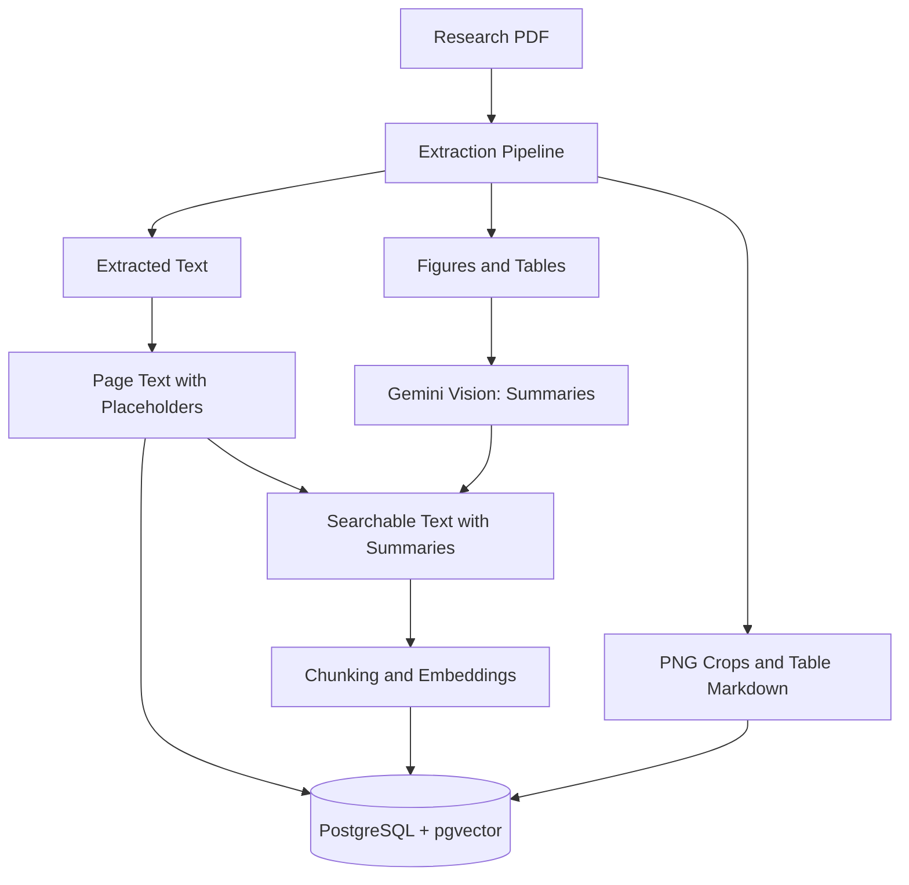
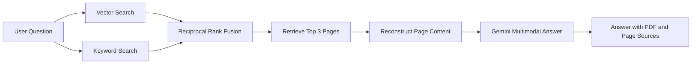

# Multimodal RAG for Research Papers

A multimodal RAG system that lets you ask questions about research papers and get accurate, source-grounded answers using their text, tables, and figures, with citations to the PDF name and page number.

The project consists of two main components:

1. **PDF Extraction Pipeline** — Extracts text, tables, and figures from research papers with different column layouts while preserving their original reading order.
2. **Multimodal RAG** — Built with LangChain, Gemini, and PostgreSQL, enabling Gemini to analyze original figures and exact tables alongside extracted text to generate context-aware answers.
---

## Extraction Pipeline

Research papers often use single-column, double-column, or mixed layouts, where full-width figures and tables may appear within two-column pages. The extraction pipeline uses PyMuPDF blocks and preserves the reading order returned by PyMuPDF without additional positional sorting, helping maintain the original sequence of content across different page layouts.

| Step | Description | Method |
|---|---|---|
| **Headers & Footers** | Identifies and removes recurring headers, footers, and logos. | Detects repeated bounding boxes across pages and applies a bottom-of-page exclusion zone. |
| **Tables** | Detects tables and converts their contents into Markdown. | Uses PyMuPDF's `find_tables`, followed by Camelot with lattice and then stream extraction as fallback methods. |
| **Images & Figures** | Detects meaningful figures while filtering out small icons and thin lines. | Extracts PyMuPDF image blocks based on minimum size thresholds. |
| **Charts & Diagrams** | Detects charts and diagrams composed of vector drawings. | Uses PyMuPDF's `cluster_drawings` to identify groups of related graphical elements. |
| **Text Extraction** | Extracts body text while excluding content inside detected table and figure regions. | Filters text blocks using their bounding-box overlap with table and figure regions. |
| **Caption Association** | Associates captions such as "Table 1" and "Figure 2" with their corresponding elements. | Matches captions and nearby text based on their spatial proximity above or below each bounding box. |
| **Reading Order** | Places tables and figures within the extracted content sequence. | Inserts each element at the first PyMuPDF text block or content block that falls within its bounding box. |
| **Image Cropping** | Saves each detected table and figure as a separate PNG image. | Crops the corresponding page region using its bounding box at 200 DPI. |


### Visualize and Validate the Extraction

The extraction_pipeline.ipynb notebook runs the extraction pipeline on a sample PDF and generates an annotated version of the original document. Each detected text block, table, and figure is outlined with a bounding box and labeled with its extraction order, making it easy to inspect the results and verify the reading sequence.

Blue: Text blocks
Green: Tables
Red: Figures
Number labels: Extraction order of each block

This visual inspection helps identify missing elements, incorrect bounding boxes, and potential reading-order issues across different page layouts.

---

## How the RAG System Works

The multimodal RAG system has two main stages: **ingestion**, which processes and indexes each PDF, and **question answering**, which retrieves relevant content and uses Gemini to generate answers grounded in the original research paper.

### 1. Ingestion — Process Each PDF Once



- **Content extraction:** The extraction pipeline separates text, tables, and figures while preserving the document's reading order.
- **Placeholders:** The original page text retains references to visual elements, such as `[[FIG:paper.pdf_p4_FIG1]]`, so each figure or table can be identified and retrieved later.
- **Visual summaries:** Gemini analyzes figures and tables to generate descriptive summaries. Table Markdown is also incorporated into the searchable text.
- **Search indexing:** The enriched text is split into chunks, converted into embeddings, and stored for semantic retrieval.
- **Database storage:** PostgreSQL with pgvector stores page text, searchable chunks, embeddings, and references to the original visual assets. Table Markdown and PNG crops are stored as retrievable assets.

The system maintains two versions of the page content: the original text with placeholders and an enriched version used for search. The original version preserves references to the source material, while the enriched version improves retrieval by including descriptions of visual content.

### 2. Question Answering — Retrieve and Generate



- **Hybrid retrieval:** Vector search identifies semantically relevant content, while keyword search finds exact terms, identifiers, and numerical values.
- **Rank fusion:** Results from both retrieval methods are combined using Reciprocal Rank Fusion (RRF) to identify the most relevant pages.
- **Page selection:** The system selects the top three pages for further analysis.
- **Content reconstruction:** Placeholders are replaced with the corresponding original figure images or Markdown tables. Up to four figure images are included per question.
- **Multimodal reasoning:** Gemini receives the retrieved text together with the original figures and exact table contents, allowing it to reason across textual and visual evidence.
- **Source attribution:** Answers include the PDF filename and page number, retrieved from database metadata rather than relying on Gemini to recall or invent citations.

**Key principle:** Figure and table summaries improve retrieval, but they are not substitutes for the original content. The summaries help locate relevant pages; Gemini then analyzes the original figure images and table data to produce evidence-grounded answers.

---
## Results

### Extraction Across Different Document Layouts

The extraction pipeline was evaluated on three research documents with different layouts to assess its ability to detect content regions and preserve the extraction order.

**Colour legend**

- 🟠 **Orange** — Headers and footers
- 🔴 **Red** — Tables
- 🔵 **Blue** — Images and figures
- 🟢 **Green** — Text blocks
- **Numbers** — Extraction order of each block

**1. DSA Project Report**

[View annotated extraction PDF](demo/pdfs/DSA_report_extraction_layout.pdf)

**2. Research Paper with Tables**

[View annotated extraction PDF](demo/pdfs/table_paper_extraction_layout.pdf)

**3. Research Paper 1**

[View annotated extraction PDF](demo/pdfs/paper_1_extraction_layout.pdf)

These annotated PDFs provide a visual way to inspect detected content regions, verify their extraction order, and evaluate how the pipeline handles different document layouts, including tables, figures, and text blocks.

### Question Answering Results

The multimodal RAG system was evaluated using two scenarios to demonstrate its ability to answer questions grounded in the research papers and handle questions that fall outside their coverage.

**1. Relevant Question — Answer with Sources and Original Figures**


The system retrieves relevant content, generates an answer using the original figures and table data where applicable, and provides source references containing the PDF filename and page number.

**2. Question Outside the Available Research Papers**


When a question is not supported by the available papers, the system demonstrates its ability to identify insufficient relevant evidence rather than generate an unsupported answer.

---

## Tech Stack

| Area | Technologies |
|---|---|
| Programming Language | Python |
| PDF Extraction | PyMuPDF, Camelot |
| LLM, Vision & Embeddings | Google Gemini (`gemini-3.5-flash-lite`, `gemini-embedding-2`) |
| Orchestration & Retrieval | LangChain (`langchain-core`, `langchain-google-genai`, `langchain-postgres`, `langchain-text-splitters`) |
| Database & Vector Search | PostgreSQL with pgvector |
| User Interface | Streamlit |

### LangChain Components

The system uses the following LangChain components to implement ingestion, retrieval, and question answering:

- `ChatGoogleGenerativeAI` — Integrates Gemini for language generation and multimodal reasoning.
- `GoogleGenerativeAIEmbeddings` — Generates embeddings for semantic search.
- `PGVector` — Stores and retrieves vector embeddings using PostgreSQL and pgvector.
- `RecursiveCharacterTextSplitter` — Splits extracted and enriched text into manageable chunks.
- Custom `BaseRetriever` — Implements keyword-based retrieval.
- `RunnableParallel` — Executes retrieval operations in parallel.
- `RunnablePassthrough.assign` — Passes and enriches data within the processing pipeline.
- **LCEL chain** — Connects retrieval, context preparation, and answer generation into a unified workflow.
---

## Project Structure

The project is organized into modules for PDF extraction, multimodal processing, database management, ingestion, retrieval, and the Streamlit interface.

```text
config.py                    # Application settings
pdf_extractor.py             # PDF extraction pipeline
models.py                    # Gemini chat model, embeddings, and image descriptions
db.py                        # PostgreSQL tables, PGVector, and keyword search
ingest.py                    # Extracts PDFs and stores content in the database
rag.py                       # Question answering with source attribution using LCEL
app.py                       # Streamlit user interface
check_setup.py               # Validates database connectivity and Gemini configuration
run_questions.py             # Runs multiple questions from questions.txt
extraction_pipeline.ipynb    # Visualizes extraction layouts and block order

demo/
├── images/                  # Result images used in the README
└── pdfs/                    # Annotated extraction-layout PDF results
```

### Database Schema

The system uses PostgreSQL to store extracted document content, visual assets, and searchable embeddings.

| Table | Purpose |
|---|---|
| `pages` | Stores page-level text with placeholders referencing figures and tables. |
| `assets` | Stores metadata for figures and tables, including captions, summaries, table Markdown, and PNG file paths. |
| `langchain_pg_embedding` | Stores searchable text chunks and their vector embeddings for semantic retrieval. |

---

## Getting Started

### Prerequisites

- Python 3.10 or later
- PostgreSQL with the pgvector extension
- A Gemini API key from [Google AI Studio](https://aistudio.google.com/apikey)

### Installation and Setup

**1. Install dependencies**

```bash
pip install -r requirements.txt
```

**2. Configure environment variables**

Copy the example environment file and add your credentials:

```bash
cp .env.example .env
```

Set the following variables in `.env`:

```dotenv
GEMINI_API_KEY=your_gemini_api_key
DATABASE_URL=your_postgresql_connection_url
```

**3. Verify the setup**

```bash
python check_setup.py
```

This checks the database connection and Gemini configuration.

**4. Initialize the database**

```bash
python db.py
```

**5. Ingest research papers**

Place your PDFs in `data/pdfs/` and run:

```bash
python ingest.py
```

The ingestion pipeline extracts text, tables, and figures, generates visual summaries, and stores the content and search embeddings in the database.

**6. Launch the application**

```bash
streamlit run app.py
```

Open the local URL displayed by Streamlit to start asking questions about your research papers.

### Command-Line Usage

You can also ask questions directly from the terminal without opening the Streamlit interface:

```bash
python rag.py "your question"
```

To run multiple questions from a file:

```bash
python run_questions.py
```

---

## Future Improvements

### Automated PDF Folder Monitoring

Add a local folder watcher using Python's `watchdog` library to keep the database synchronized with changes to the PDF collection.

- **New PDF:** Automatically extract its content and add it to the database.
- **Modified PDF:** Reprocess the document and replace its existing pages, assets, and embeddings.
- **Deleted PDF:** Remove the corresponding pages, assets, and search chunks from the database.

This enhancement would eliminate the need to trigger ingestion manually whenever the document collection changes.

The goal is to maintain an automatically synchronized, locally managed research-paper knowledge base with minimal manual intervention.


### Web Search Fallback

- **External search:** If the research papers do not contain sufficient information to answer a question, automatically search the web for relevant information.
- **Combined sources:** Include web references alongside PDF citations, clearly distinguishing external sources from research-paper sources.
- **Source attribution:** Provide links to web pages and cite the PDF filename and page number for information retrieved from the papers.
- **Evidence-based answers:** Prioritize relevant evidence from the uploaded papers and use web results to supplement missing information, avoiding unsupported claims.
