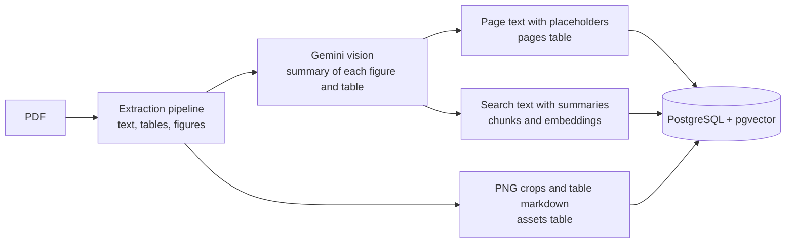
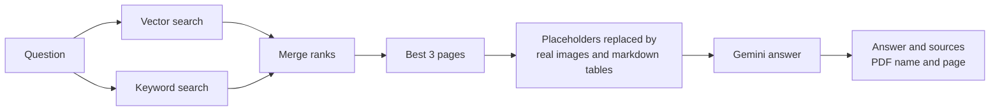
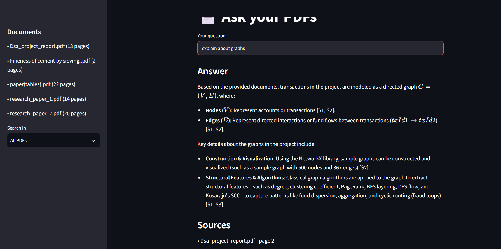
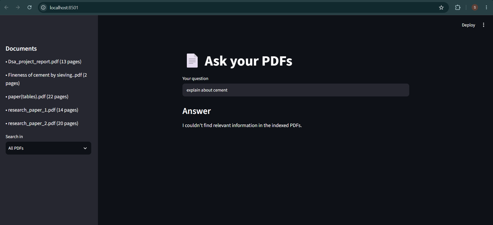

# Multimodal RAG for Research Papers

Ask questions about research PDFs and get answers that use the **text, tables and figures**, with **sources (PDF name and page)**.

The project has two parts:

1. **An extraction pipeline** that reads research papers of any column layout and keeps text, tables and figures in the right order.
2. **A multimodal RAG** built with LangChain, Gemini and PostgreSQL. Gemini reads the original figures and the exact tables, not only a text summary.

---

## Extraction pipeline

Research papers come as single-column, double-column and mixed layouts (for example, full-width figures and tables inside a two-column page). The pipeline works on PyMuPDF blocks and keeps the order PyMuPDF gives. **Nothing is re-sorted by position**, so column order is not disturbed.

| Step | What it does | How |
|---|---|---|
| Headers, footers, logos | Removes them | Boxes that repeat at the same place on several pages, plus a bottom-of-page zone |
| Tables | Finds them and keeps them as markdown | PyMuPDF `find_tables`, then Camelot (lattice, then stream) |
| Images | Finds figures, ignores icons and thin lines | PyMuPDF image blocks with a minimum size |
| Charts | Finds charts drawn with lines | PyMuPDF `cluster_drawings` |
| Text | Keeps body text blocks only | Text inside a table or figure box is removed |
| Captions | Links "Table 1" / "Figure 2" and nearby text to each table or figure | Position above or below the box |
| Placement | Puts each table or figure at its place in the text order | At the first PyMuPDF block that lies inside it |
| Crops | Saves every table and figure as a PNG | 200 dpi crop of the bounding box |

### Check the extraction visually

`extraction_pipeline.ipynb` runs the extractor on one PDF and saves the same PDF with every bounding box and the block order drawn on it. Blue is text, green is a table, red is a figure, and the number on each box is its order.

---

## How the RAG works

### Ingest (once per PDF)



- Where a figure or table was, the page text keeps a placeholder such as `[[FIG:paper.pdf_p4_FIG1]]`.
- A second copy of the text has the Gemini summary (and the table markdown) written in that place. It is cut into chunks and embedded. This copy is only used for search.
- Tables are stored as markdown. Figures are stored as PNG files, and the database keeps their path.

### Ask (every question)



- Vector search finds similar meaning. Keyword search finds exact names and numbers. Their results are merged with reciprocal rank fusion.
- The best pages are rebuilt for Gemini: every placeholder becomes the real PNG (figures, up to 4 per question) or the markdown table.
- The summaries help to **find** the right page. The original images and tables are what Gemini **reads**.
- Sources are read from the database labels, not from the model's memory.

---

## Results

### Extraction on different layouts

Same pipeline, three layouts. Header and footer: orange, Tables: red, Images: blue and Text: green with ordered numbers the output order.

`demo/pdf/DSA_report_extraction_layout.pdf`
`demo/pdf/table_paper_extraction_layout.pdf`
`demo/pdf/paper_1_extraction_layout.pdf`

### Question answering

**Relevant question: answer with sources and the original figure**



**Question not covered by the papers**



---

## Tech stack

| Area | Tools |
|---|---|
| Language | Python |
| PDF extraction | PyMuPDF, Camelot |
| LLM, vision, embeddings | Google Gemini (`gemini-3.5-flash-lite`, `gemini-embedding-2`) |
| Orchestration | LangChain (`langchain-core`, `langchain-google-genai`, `langchain-postgres`, `langchain-text-splitters`) |
| Database | PostgreSQL with pgvector |
| Interface | Streamlit |

LangChain parts used: `ChatGoogleGenerativeAI`, `GoogleGenerativeAIEmbeddings`, `PGVector`, `RecursiveCharacterTextSplitter`, a custom `BaseRetriever` for keyword search, `RunnableParallel`, and an LCEL chain with `RunnablePassthrough.assign`.

---

## Project structure

```
config.py                   settings
pdf_extractor.py            extraction pipeline
models.py                   Gemini chat model, embeddings, image description
db.py                       PostgreSQL tables, PGVector, keyword search
ingest.py                   PDF to database
rag.py                      question to answer with sources (LCEL chain)
app.py                      Streamlit page
check_setup.py              tests the database and Gemini
run_questions.py            runs many questions from questions.txt
extraction_pieline.ipynb      give extraction layoutpdf         
demo/images/                result images used in this README
demo/pdfs                   extraction layout pdf results
```

| Table | Holds |
|---|---|
| `pages` | page text with placeholders |
| `assets` | every figure and table: caption, summary, table markdown, PNG path |
| `langchain_pg_embedding` | chunks and their vectors |

---

## Getting started

Requires Python 3.10+, a PostgreSQL database with pgvector, and a free Gemini API key from https://aistudio.google.com/apikey.

```bash
pip install -r requirements.txt
cp .env.example .env          # add GEMINI_API_KEY and DATABASE_URL
python check_setup.py         # tests the database and Gemini
python db.py                  # creates the tables
python ingest.py              # reads the PDFs in data/pdfs/
streamlit run app.py          # opens the web page
```

Command line: `python rag.py "your question"`

---

## Future improvements

**Local folder watcher**
- Watch one local folder with `watchdog`.
- New PDF: extract and add it to the database.
- Changed PDF: replace its old data.
- Deleted PDF: remove its pages, assets and chunks.
- The database then stays in sync with the folder, running fully locally.

**Web search**
- When the papers do not contain the answer, search the web.
- Show web sources next to the PDF sources in the answer.